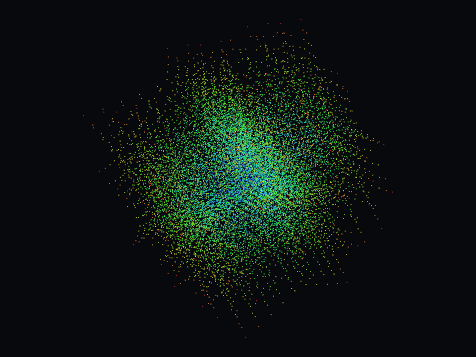
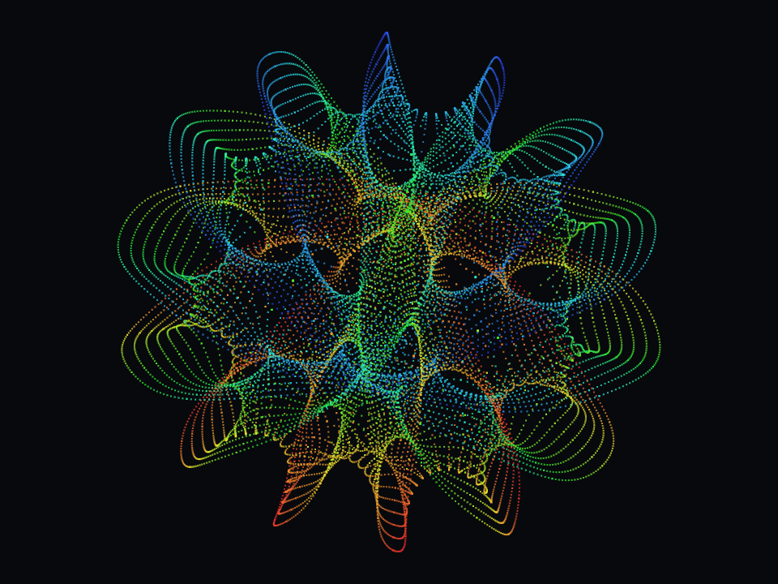

# Calabi–Yau Projection Lab


[](https://doi.org/10.5281/zenodo.24297863)

**Live Demo:** [amurlaniakea.github.io/calabi-yau-projection-lab](https://amurlaniakea.github.io/calabi-yau-projection-lab/)

**Static Branch Gallery:** [amurlaniakea.github.io/calabi-yau-projection-lab/quintic-branch-gallery.html](https://amurlaniakea.github.io/calabi-yau-projection-lab/quintic-branch-gallery.html)





*Screenshots from the software.*

«Tecnósfera al servicio de la Biósfera.»
«La Paz Es El Camino.»

A professional, zero-dependency laboratory for projecting, slicing and visually encoding higher-dimensional geometric objects onto 2D planes.

> **Scope:** mathematical visualization, reproducibility and education.
> This is **not** a string theory simulator, **not** a fractal engine, and **not** a claim that a 2D image is the "true form" of a 6D/11D object.

## What it does

- Orthogonal projections `R^n -> R^2` using deterministic orthonormal bases.
- Toy manifolds and domains:
  - 6D hypercube grid.
  - 11D random domain.
  - Flat torus fundamental domain.
  - Unit n-sphere sample.
  - Calabi–Yau-like Fermat patch in `R^4`.
  - Clifford torus in `R^4` (S^1 x S^1 embedded in S^3).
  - Quintic threefold affine chart in `R^8` (local, 5 branches).
- Slices with frozen coordinates.
- Exact Fermat Hodge numbers and Euler characteristics via integer combinatorics.
- Reproducible quintic branch gallery: five local sheets under the same camera.
- Fubini-Study induced metric diagnostics on the quintic chart (approximation, not Ricci-flat).
- Metadata JSON sidecars describing reproducible outputs; point-level datasets are not yet exported by default.
- Reproducible SVG output and SHA-256 hashes.
- Local interactive HTML/Canvas demo, no CDN, no framework.
- Tests as evidence (45 tests).

## Pedagogy and audience

This repository is intended as an open educational resource for university teaching, reproducible visualization and scientific outreach.

- [Pedagogical guide](docs/02-pedagogy.md)
- [Research and professional use](docs/03-research-and-professional-use.md)
- [Object gallery](docs/04-object-gallery.md)
- [Physics-oriented roadmap](docs/05-physics-roadmap.md)
- [Degree and patches clarification](docs/06-degree-and-patches.md)
- [Equations, Clifford torus and PSM note](docs/07-equations-and-psm.md)
- [Classroom lab sheet](docs/08-classroom-lab-sheet.md)
- [Quintic threefold chart](docs/09-quintic-threefold-chart.md)
- [Quintic branch gallery](docs/quintic-branch-gallery.html)
- [Metric diagnostics](docs/10-metric-diagnostics.md)
- [Metadata and data contract](docs/11-metadata-and-data-contract.md)

For instructors: use the CLI and local demo to show projections, slices, Clifford torus, Fermat patches and hidden-coordinate encoding.

For researchers: treat outputs as reproducible educational projections, visual prototypes and exact discrete invariants, not as rigorous computations of Calabi–Yau metrics, topology or physical compactification.

For students: the key lesson is that a 2D image of a 6D/11D object is a shadow, cut or encoding, not the true form of the object.

## Architecture

```text
calabi-yau-projection-lab/
├── src/projection_lab/
│   ├── linalg.py          # dot, norm, Gram-Schmidt
│   ├── basis.py           # deterministic orthonormal bases
│   ├── project.py         # R^n -> R^2 projection
│   ├── manifolds.py       # hypercube, torus, sphere, CY-like patch, Clifford torus, quintic chart
│   ├── slices.py          # fixed-coordinate slices
│   ├── topology.py        # exact Fermat Hodge numbers and Euler characteristic
│   ├── metrics.py         # Fubini-Study induced metric diagnostics (approximation)
│   ├── render_svg.py      # reproducible SVG renderer
│   └── cli.py             # command line interface
├── tests/
│   ├── test_core.py       # 35 core tests as evidence
│   └── test_metrics.py    # 10 metric diagnostics tests as evidence
├── docs/
│   ├── index.html         # zero-dependency interactive demo with object selector, quintic branch explorer and MathML equations
│   ├── 00-sdd.md          # Software Design Document
│   ├── 01-limitations.md  # explicit non-goals and limits
│   ├── 02-pedagogy.md     # classroom guide
│   ├── 03-research-and-professional-use.md
│   ├── 04-object-gallery.md
│   ├── 05-physics-roadmap.md
│   ├── 06-degree-and-patches.md
│   ├── 07-equations-and-psm.md
│   ├── 08-classroom-lab-sheet.md
│   ├── 09-quintic-threefold-chart.md
│   ├── 10-metric-diagnostics.md
│   ├── 11-metadata-and-data-contract.md
│   ├── quintic-branch-gallery.html # static five-branch gallery
│   └── assets/            # SVG previews for README, quintic branch gallery and static pages
├── examples/              # generated SVG + JSON metadata
├── Makefile
├── LICENSE                # AGPL-3.0-or-later
└── .github/workflows/ci.yml
```

## Quickstart

Pure Python 3 standard library plus static HTML/JS. Runs on Linux, macOS and Windows.

Requires Python 3.10+ and Git. No third-party runtime dependencies.

Clone and enter the repository:

    git clone https://github.com/amurlaniakea/calabi-yau-projection-lab.git
    cd calabi-yau-projection-lab

Run tests and generate examples:

    make test
    make examples

Optional reproducible galleries:

    make quintic-gallery
    make quintic-gallery-previews
    make metric-diag

If you do not have `make`:

    PYTHONPATH=src python3 -m unittest discover -s tests -p 'test_*.py' -v

Open the interactive demo:

- Online: <https://amurlaniakea.github.io/calabi-yau-projection-lab/>
- Local: open `docs/index.html` in any browser.
- Linux: `xdg-open docs/index.html`
- macOS: `open docs/index.html`
- Windows PowerShell: `start docs\index.html`

## CLI examples

```bash
# 6D hypercube projection
PYTHONPATH=src python3 -m projection_lab.cli cube --dim 6 --steps 4 --seed 1 --out examples/cube6d.svg

# 11D random domain projection
PYTHONPATH=src python3 -m projection_lab.cli domain --dim 11 --samples 2500 --seed 2 --out examples/domain11d.svg

# Calabi-Yau-like Fermat patch in R^4
PYTHONPATH=src python3 -m projection_lab.cli cy-patch --degree 5 --resolution 14 --seed 3 --out examples/cy_patch.svg

# Clifford torus in R^4
PYTHONPATH=src python3 -m projection_lab.cli clifford-torus --samples-u 48 --samples-v 48 --seed 5 --out examples/clifford_torus.svg

# 6D slice with frozen coordinates
PYTHONPATH=src python3 -m projection_lab.cli slice --dim 6 --steps 6 --fixed 3=0.25,4=0.75 --seed 4 --out examples/slice6d.svg

# Exact Fermat topology: quintic in CP^4
PYTHONPATH=src python3 -m projection_lab.cli topology --degree 5 --ambient 4 --out examples/topology_quintic.json

# Quintic threefold affine chart in R^8
PYTHONPATH=src python3 -m projection_lab.cli quintic-chart --grid 4 --branch 0 --seed 6 --out examples/quintic_chart_g4_b0.svg

PYTHONPATH=src python3 -m projection_lab.cli metric-diag --grid 3 --branch 0 --seed 6 --sample 50 --meta examples/metric_diag_quintic_g3_b0.json
```

## Reproducibility contract

Every generated SVG includes deterministic metadata:

- object type
- dimension
- seed
- basis seed
- point count
- color mode

The same inputs produce the same SVG and the same SHA-256 hash.

Exact topology output includes:

- degree and ambient dimension
- Calabi–Yau condition check
- Hodge numbers (integer, not float)
- Euler characteristic
- note on limitations

## Limits

See `docs/01-limitations.md` and `docs/05-physics-roadmap.md`.

In short:

- A 2D projection loses information.
- The Calabi–Yau-like patch is not a full compact Calabi–Yau threefold.
- The Clifford torus is a smooth 2D surface in 4D, not a CY threefold.
- Hodge numbers are exact integer combinatorics for known Fermat families, not metric computations.
- Float64 precision is explicit.
- No physics claims are made.
- No external runtime dependencies are used.
- PSM / Donaldson / ML metric layers are documented as future sibling-repo work, not implemented here.
- Metric diagnostics are Fubini-Study induced approximations on tangent spaces, not Ricci-flat Calabi-Yau metrics.
- JSON files beside SVG outputs are reproducibility metadata manifests, not full point-cloud datasets.

## Citation

Please cite this repository using the metadata in `CITATION.cff`.

Concept DOI (all versions): [10.5281/zenodo.24297863](https://doi.org/10.5281/zenodo.24297863)

Version DOI (v0.5.0): [10.5281/zenodo.24297864](https://doi.org/10.5281/zenodo.24297864)

Suggested citation:

> Sordo Martínez, Pedro. (2026). Calabi–Yau Projection Lab [Computer software]. Zenodo. https://doi.org/10.5281/zenodo.24297863

## License

AGPL-3.0-or-later.

© 2026 Pedro Sordo Martínez <amurlaniakea@gmail.com>

<details>
<summary>Resumen en español</summary>

Laboratorio reproducible de proyecciones geométricas de alta dimensión.

Permite proyectar objetos de `R^6`, `R^11` y parches tipo Calabi–Yau en planos 2D mediante bases ortonormales deterministas, cortes/slices y codificación visual de dimensiones ocultas.

Incluye toro de Clifford en 4D (S^1 x S^1 embebido en S^3) y números de Hodge exactos por combinatoria entera para familias de Fermat conocidas (quíntica CY3: h^{1,1}=1, h^{2,1}=101, χ=−200; K3: χ=24; curva elíptica: χ=0).

No es un simulador de teoría de cuerdas. No es un motor de fractales. No afirma que una imagen 2D sea la forma real de un objeto 6D u 11D. No calcula métricas Ricci-planas.

Incluye:

- núcleo matemático en Python sin dependencias externas;
- render SVG reproducible con SHA-256;
- 45 tests como evidencia;
- demo local HTML/Canvas sin CDN con selector de objeto, seed de cámara, leyenda de color y ecuaciones MathML nativas;
- documentación pedagógica, galería de objetos, roadmap físico, ficha de laboratorio universitaria;
- licencia AGPL-3.0-or-later.

</details>
